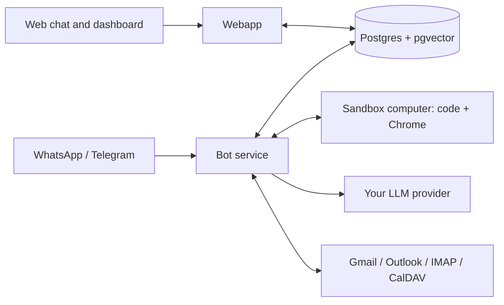

# Closedhand

Personal AI without signing your life away.

Closedhand is a private AI assistant that runs on your own computer. Connect any app or service you use, from your mail and chats to your files, bank and work tools, and none of it ever needs to leave your computer. Talk to it in WhatsApp, Telegram or the web chat. Ask "What wine did Tom like?" and it answers "A 2019 Rioja. He said so on WhatsApp." It also speaks up before you ask: "Your flight's delayed. You'll miss your train."

## Why Closedhand

AI assistants from the frontier labs run on the lab's own servers, with its own models, on its own terms. Closedhand runs on a computer you control, works with any LLM and belongs to you.

**Built for local, because local is safer.** AI is making attacks cheaper, faster and more convincing, and a company holding the mail, messages and health questions of millions of people is the prize that makes them worth it. Closedhand keeps your data on a computer you control: your own Mac or PC, a rented server or a server in your own Railway account. One computer can be attacked too, but it holds one person's life, not millions. Your conversations, mail and files never reach closedhand.com. If you turn on Closedhand's own email address, mail to it passes through closedhand.com sealed so that only your computer can read it.

**The LLM can be local too.** LLMs keep getting smarter and smaller, and more of them run well on an ordinary computer. Closedhand can use one today, and then no company sees what you ask at all. With a hosted LLM you still need no company in the middle: with your own LLM provider's key, Closedhand talks to that provider directly.

**Any LLM, chosen for you, not for a lab.** A frontier lab's assistant runs on that lab's own models and works with what fits its platform. Closedhand works with any LLM from any provider, free ones included, and you can switch the day a better one is out. It has no LLM of its own to promote, so the only things it weighs are how well it works for you and how private it keeps you. If you'd rather not choose, Closedhand Managed Models pick the best LLM for each job, only from LLM providers that keep nothing you send.

**It can know what you'd never hand over.** An assistant is only as good as what it knows about you, and most people would never give a big tech company their health records or bank statements to keep. Closedhand keeps them on your computer, so it can know them, and with a local LLM nothing ever leaves it.

**It already knows your world.** The Preemptive Context Layer keeps one live picture of your world and searches it once, before the LLM reads your message, so every answer starts from what you've said, sent and planned. The design is published at [closedhand.com/pcl](https://closedhand.com/pcl) for anyone to use.

**It comes to you.** You talk to it in the chat apps you already use, and with Pulse turned on it checks your connected services and messages you when something needs your attention.

**It's yours.** Closedhand is free and open source under the Apache 2.0 licence. There's no subscription to use it, no change of terms can take back the code you run, and you can change any part of it to suit you.

## Get started

**The Mac app.** Download Closedhand for Mac from the [latest release](https://github.com/notnotjim/Closedhand/releases/latest), drag it to Applications and open it. It needs an Apple Silicon Mac with macOS 14 or later. It runs from the menu bar, opens the setup page the first time, and can work with that Mac's files and apps through permissions you choose. Your data lives in `~/Library/Application Support/ClosedHand`. The app is signed and notarised, and its source is in [`desktop/`](desktop/).

**Docker**, on a Mac, a Windows PC, Linux or a rented server. Docker runs each part of Closedhand (the assistant, the dashboard, its database and the sandbox computer) in its own sealed-off container, so nothing else needs installing. On a Mac or a Windows PC that means [Docker Desktop](https://www.docker.com/products/docker-desktop/), free for personal use; on Linux, [Docker Engine](https://docs.docker.com/engine/install/). Then run:

```sh
curl -fsSL https://closedhand.com/install | sh
```

Or, if piping a script into your shell is what you self-host to avoid, download it, read it (it is short) and run it:

```sh
curl -fsSL https://raw.githubusercontent.com/notnotjim/Closedhand/main/install.sh -o install.sh
less install.sh
sh install.sh
```

It checks for Docker, clones this repo, writes a `.env` with generated secrets, downloads pre-built images (nothing compiles on your machine) and starts everything. The same by hand:

```sh
git clone https://github.com/notnotjim/Closedhand.git closedhand
cd closedhand
cp .env.example .env
docker compose up -d
```

If you run Closedhand with Docker on a Mac, it can use that Mac’s files and apps through the optional Closedhand Bridge app: download it from your dashboard and install it on the same Mac. Choose what to allow from Bridge in the menu bar.

Working on Closedhand itself? Build from source with `docker compose -f docker-compose.yml -f docker-compose.build.yml up -d --build` (or `CLOSEDHAND_BUILD=1 sh install.sh`).

**Setup.** The setup page opens in your browser (or at **http://localhost:3000**) and ticks off each step as it sees it done:

1. **Models.** Closedhand Managed Models, with a first month at no charge and no card needed, or your own LLM provider.
2. **A password** for your dashboard.
3. **Email and calendar.** Google, Microsoft or both. Google takes one sign-in through Closedhand's own Google app, or about five minutes through a free Google Cloud project of your own, which setup walks you through.
4. **Your personal URL**, so you can open Closedhand from your phone or any browser.
5. **Chat apps.** WhatsApp on your own number, linked the way WhatsApp on a laptop is, with Closedhand in your "Message Yourself" chat. Or Telegram, with a bot of its own.

By the time you say hello, Closedhand has already read your inbox and calendar.

## What it does

**Chat that acts.** Closedhand answers, and it also sends mail, books calendar events, sets reminders, tracks flights and runs tasks in the background that report back when they're done. Sending a message on your behalf or spending money is put to you first.

**Context Brain.** Pinned Facts about you, Context Notes from past conversations and your documents, all recalled by meaning, not just keywords. Ask "what did the accountant say about the deadline" and it finds the thread though you never said "email"; ask for an invoice number and it matches the number itself. You can see, edit and delete any of it on the dashboard.

**File Search.** Your files, PDFs, scans, pictures and recordings, found by what is in them.

**Pulse.** When it is on, Closedhand checks your connected services and messages you when something needs your attention: a delayed flight, a reply you were waiting for, a clash in your plans.

**Projects.** A move, a wedding or a client gets its own conversation, notes and files, and an emoji that files a message into it from any chat app.

**Pages.** When something works better as a page than a chat reply, Closedhand makes one, with PDF, Word and Excel versions, and keeps it under Pages on the dashboard.

**The sandbox computer.** Closedhand browses and runs code on its sandbox computer, which has its own Chrome and files that survive restarts. It can't see your files or the rest of the computer it runs on unless you connect them yourself. Watch it work on the dashboard's Computers tab.

**Connect anything.** Paste an MCP server's web address, the `npx` or `uvx` command from its README or its JSON block, and Closedhand connects to it; skill files work the same way, and each is checked for prompt injection and impersonation before it is switched on. Calendars over CalDAV (iCloud, Fastmail, Nextcloud) need no Google or Microsoft at all, and bank accounts connect read-only through SimpleFIN (US) or Lunch Flow (UK and EU).

**A dashboard that tells the truth.** Connections, tasks, projects, pages, Context Brain and a usage tab that shows what your own LLM provider charges, feature by feature, from its own numbers.

## LLMs

Closedhand is free software and works with any LLM you choose, free ones included: Anthropic, DeepInfra, DeepSeek, Gemini, Groq, Moonshot, OpenAI, OpenRouter, xAI, any OpenAI-compatible endpoint, or a model running on your own computer. The LLM provider you choose sees what you ask under its own terms; with a model on your own computer, no company does.

Closedhand Managed Models are a convenience if you'd rather not choose. They come with a first month at no charge, once per person, and then carry on with Closedhand+, an optional monthly subscription. You can switch to your own LLM provider at any time.

## Where it runs

Closedhand lives on one computer and you reach it from anywhere. On a laptop it is there while the laptop is awake. When it wakes, it fetches the mail and calendar changes it missed and answers WhatsApp messages sent in the last 12 hours, but a schedule due while it slept is skipped. On a computer that stays on (a desktop, a Mac mini, an old PC or a small rented server), Pulse, schedules and tasks run day and night.

Closedhand's data moves from Always on in My Account, to a computer that stays on. It can go to a computer of your own, like a Mac mini at home: set Closedhand up there, choose Bring Closedhand from another computer in its setup, and type the move code My Account shows; it fetches everything through your personal URL. Or it can go to a server in your own Railway account, and from there back to a computer of your own the same way, after which you delete the project on Railway. Either way this computer then stops running Closedhand and, once the new one runs, clears everything Closedhand kept on it. Setting Closedhand up anywhere else without moving it starts with an empty Context Brain, no connections and no history.

Closedhand starts again by itself after a restart, once someone logs in; a Mac with FileVault turned on waits for that login. The Mac app turns on Launch at Login the first time it opens, and the installer turns on Docker Desktop's "Start Docker Desktop when you sign in"; either can be turned off. On Linux, Docker itself must start with the computer (`sudo systemctl enable docker`). With the Mac app, also turn on Keep Mac Awake in the menu bar; it can't stop a laptop sleeping when its lid is closed.

**On a rented server.** Rent a small Linux server (see Requirements for how much memory), install [Docker Engine](https://docs.docker.com/engine/install/), connect over SSH and run the install command above. It then prints an `ssh -N -L 3000:127.0.0.1:3000 user@server` command: run that on your own computer, keep it open and open http://localhost:3000 to finish setup. After that your personal URL reaches Closedhand from any device. The hosting company provides the machine, so choose one you trust and turn on disk encryption where it offers it.

## Your personal URL and account

Setup gives Closedhand a personal URL, two ordinary words and a number like amber-fox-42, so it says nothing about you. Open it from any device whenever the computer running Closedhand is awake and online; your dashboard password is always required. Bookmark it, pin it in a chat app or add it to your phone's home screen.

Claiming the URL creates your Closedhand account on closedhand.com. You sign in to it with Google or Microsoft, and it stores your email and nothing else; the [privacy page](https://closedhand.com/privacy) lists the routing details it needs to carry the connection. Connecting Google or Microsoft through Closedhand's own app claims the URL with that same sign-in. With your own Google project, setup asks for a second sign-in on closedhand.com, because closedhand.com can't trust a sign-in made by someone else's project.

You can rename the URL in **Settings → Personal URL**; the old address points to the new one for 30 days. **Delete account** in My Account deletes your Closedhand account and everything Closedhand keeps on that computer. Without the computer, sign in at closedhand.com/account to delete the account alone.

## Privacy and security

Each Closedhand serves one person. The first person to message it on a chat app becomes its owner, and strangers get one polite refusal; `ALLOWED_*` lists in `.env` can extend or restrict that. The dashboard password you choose in setup locks every page but setup itself; `ADMIN_PASSWORD` in `.env` overrides it for scripted setups. Keys and sign-ins are encrypted on disk. Your data goes only to the services you connect and the LLM provider you choose. There is no telemetry: a bug report is sent only when you send `/bug` and say yes. Pages you open through your personal URL pass through Closedhand's relay on Cloudflare, encrypted on the way and not kept.

## Requirements

The Mac app, or Docker with the compose plugin on amd64 or arm64 (Apple Silicon and ARM servers included). With an LLM provider that also serves an embedding model, such as DeepInfra, OpenAI or Gemini, 2 GB of RAM runs everything. With one that doesn't, such as Anthropic, xAI or Groq, Closedhand downloads a small local embedding model (about 330 MB, once) so recall still works, and up to 500 MB more the first time File Search reads a picture or a recording: plan for 4 GB. On a tight server you can leave out the sandbox computer and stay nearer 2 GB.

## Architecture



Two Node services, the bot and the webapp, share a Postgres database with pgvector and never import each other's code; the sandbox computer runs beside them. `docker compose up` starts all four and sets up the database on first start. The Mac app runs the same services on the Mac itself.

## What it isn't

Closedhand serves one person, deliberately, and it is not a hosted service: it runs where you put it. It is a young project with one maintainer, and support happens in GitHub issues with no promise of response times.

## Reporting a problem

Send `/bug` in the web chat or a chat app, with what went wrong or on its own: the last
few messages of the chat show what happened. Closedhand says what it would send and asks
first, and only a yes sends it to Closedhand. Nothing is kept on your computer. When the
problem is fixed, Closedhand tells you.

## Contributing

Issues and pull requests are welcome. Open an issue before starting anything sizeable so the approach can be agreed first. A genuinely useful first contribution: run `install.sh` on a clean Linux box or WSL and report what breaks. Contributor rules are in [AGENTS.md](AGENTS.md).

## License

[Apache License 2.0](LICENSE). Third-party components keep their own licences.
